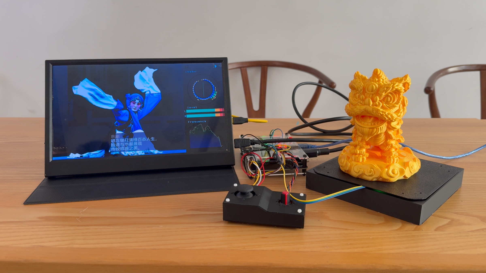
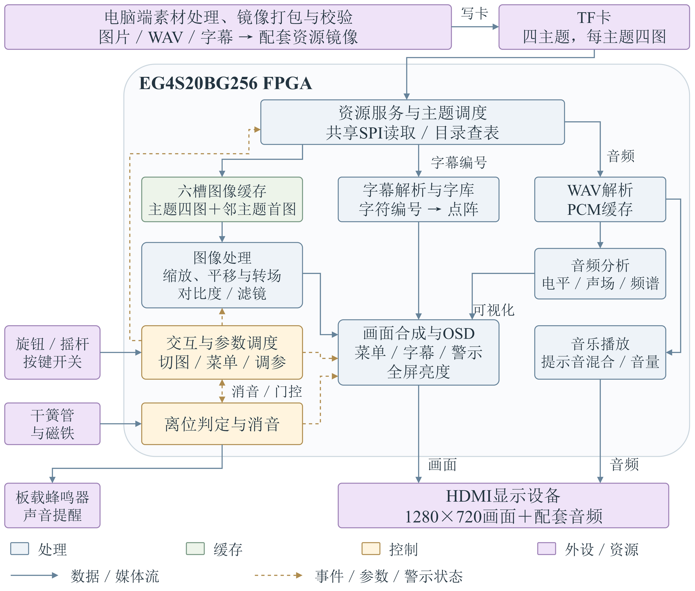

# Intangible Cultural Heritage FPGA HDMI Showcase

**基于安路 EG4S20BG256 FPGA 的非遗数字 HDMI 展示系统**

以 HX4S20 开发板为平台，从 TF 卡读取离线打包的图片、音乐和字幕，输出 1280×720 HDMI 音画。系统展示京剧、醒狮、古琴、打铁花四个主题，每主题四张图片，并提供实体交互、音频可视化和展品离位报警。



## 快速开始

1. 在 [v1.0.0 发布页](https://github.com/yymBobby/Intangible-Cultural-Heritage-FPGA-HDMI-Showcase/releases/tag/v1.0.0) 下载完整发布包 `Intangible_Cultural_Heritage_FPGA_HDMI_Showcase_v1.0.0.zip`，解压到英文路径。
2. 安装安路 Tang Dynasty 6.2.1 Engineer（原签核版本 6.2.168.116），在“文件 → 打开工程”选择：

   `01_FPGA_Project/src/td_project/Media_AV_Visualizer_Ultimate.al`

3. 直接使用配套 BIT 时，选择 `02_Bitstream/MediaAV_ReedAlarm_Font176_20261026.bit`。
4. 将发布附件 `showcase_font176.img` 用原始镜像写卡工具写入 TF 卡，不能只把 IMG 复制到卡内。
5. 按 [接线与操作说明](00_Documentation/Controls_And_Wiring.md) 连接旋钮、摇杆及干簧管。

源码 ZIP / `git clone` 提供完整 FPGA 工程和工具；媒体素材另下载 `media_assets.zip` 并解压到仓库根目录。完整发布包已包含素材、BIT、IMG及校验文件，无需分别补齐。

## 功能

| 部分 | 实现 |
|---|---|
| 资源读取 | 共享 SPI 读卡、目录查表、图像/音频请求仲裁、扇区缓存 |
| 图像缓存 | 六槽保存当前主题四图和前后主题首图，标签命中后复用图像 |
| 图像显示 | 640×480 源图映射至 960×720 图片区，双线性插值、100%/150%/200%缩放和平移 |
| 转场与图像调节 | 滑动、双图交叉淡化、原图/灰度/怀旧、图片对比度和全屏亮度 |
| 音频 | 主题音乐循环，25%/50%/75%/100%音量；电平、声场、频谱三类可视化 |
| 实体交互 | 两级菜单，旋钮调参，摇杆导航；自动轮播间隔5/10/20/30秒，默认10秒 |
| 连续切图 | 150 ms输入间隔、八条顺序队列、32/16帧滑动与安全提交/释放 |
| 离位报警 | 干簧管与磁铁检测，顶部半透明警示及蜂鸣；按压消音后恢复浏览，归位解除 |

本版**菜单外点按旋钮切主题**，旋钮旋转或100%档摇杆左右切同主题图片；放大后摇杆平移。具体门控和报警按压规则见操作文档。

## 系统组成



控制域40 MHz、存储域50 MHz、像素域75 MHz，HDMI有效画面1280×720。左侧960×720显示非遗图片，右侧320×720显示音频可视化，图片区叠加菜单、字幕与离位提示。

## 文件导航

| 目录 | 内容 |
|---|---|
| [00_Documentation](00_Documentation) | 快速使用、接线、架构、资源格式、软件流程及精选图件 |
| [01_FPGA_Project](01_FPGA_Project) | 唯一主工程，完整RTL/IP/ROM、引脚与时序约束 |
| [02_Bitstream](02_Bitstream) | 配套最终BIT及SHA256 |
| [03_Software](03_Software) | 字模生成、发布字库重建、图片裁切、镜像构建与校验 |
| [04_Media](04_Media) | 主题配置、裁切记录、镜像manifest及媒体下载说明 |
| [05_Verification](05_Verification) | 源码检查、版本对应、原始签核和整理验证结果 |
| [06_Simulation](06_Simulation) | 12组精选RTL回归、便携Python入口和ModelSim脚本生成 |

## 复现与验证

```text
python 05_Verification/check_package.py
python 06_Simulation/run_tests.py --list
python 06_Simulation/run_tests.py
```

完整素材解压后，可运行：

```text
python -m pip install -r 03_Software/requirements.txt
python 03_Software/tools/font_compact/build_assets.py
python 03_Software/tools/image_processing/batch_crop.py
python 03_Software/rebuild_image.py
```

详见 [软件流程](00_Documentation/Software_Workflow.md) 和 [仿真说明](06_Simulation/README.md)。字库、图像和镜像已在整理阶段重建并与正式发布内容逐字节核对。仿真包含行为存储模型，用于逻辑验证；实现签核以配套BIT的TD报告为准。

| 最终BIT配套指标 | 结果 |
|---|---|
| LUT / REG | 19082/19600；12082/19600 |
| BRAM9K / BRAM32K | 62/64；13/16 |
| DSP | 16/29 |
| 外部SDRAM图像槽位 | 7.03125/8 MiB |
| Setup / Hold最小裕量 | +0.338 ns / +0.024 ns |
| STNS / HTNS；STA覆盖率 | 0 / 0 ns；99.99% |

本次公开整理沿用上述正式BIT及原始签核报告，验证摘要见 [Public_Validation](05_Verification/Public_Validation.md)。

## 版本、来源与贡献

本仓库整理自 [原团队开发仓库](https://github.com/yymBobby/Intangible_Cultural_Heritage_Digital_HDMI_Showcase_System) 的 `the-second-stage`，固定提交 `4b0f5f677f5e04a115c8462dd7f8670ccc821645`。原仓库保留团队成员的完整提交与开发历史；本仓库集中提供正式版本及可复现材料。源码对应关系见 [来源记录](05_Verification/source_provenance.json)。

公开整理不改变生产RTL、IP、ROM和约束。`ICHSHOW3`、`ICHTXT02`及既有文件名是协议/兼容标识，保持原值。厂商IP、第三方工具、素材与字体的适用说明见 [THIRD_PARTY_NOTICES](THIRD_PARTY_NOTICES.md)。
